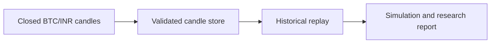

# TradeOS

**A personal quantitative research project for Bitcoin spot.**

TradeOS uses historical BTC/INR data from Delta Exchange India to study market behavior, simulate execution in INR, and measure the risk and performance of trading models.

## Workflow

TradeOS preserves missing intervals as gaps and derives larger candles only from complete sets of smaller ones. Parquet holds the candle batches, and SQLite indexes them and stores backtest reports.

The Python replay engine uses closed candles and records decisions with version and reason codes. FastAPI exposes market data, signals, and saved reports.

## Backtest example

The simulator accounts for fees, spread, slippage, liquidity limits, and partial fills. Each report includes an order and fill ledger, closed trades, a candle-close equity curve, and a buy-and-hold benchmark.

*Both runs use synthetic data and start with ₹100.00. Simulated equity ends at ₹99.00, and the buy-and-hold benchmark ends at ₹99.90.*

## Quantitative analysis

Let $E_t$ be portfolio equity at time $t$, with starting equity $E_0$ and final equity $E_T$. For daily risk metrics, $r_d$ is the return between consecutive UTC midnight marks, $\bar{r}$ is its sample mean, and $s_r$ is its sample standard deviation.

| Metric | Calculation |
| --- | --- |
| Total return | $E_T / E_0 - 1$ |
| Maximum drawdown | Largest fractional decline from a running equity peak, $\max_t (1 - E_t / \max_{s \le t} E_s)$ |
| Net expectancy | Mean net profit or loss per completed trade, including modeled trading costs |
| Profit factor | Sum of winning trades' net profits divided by the absolute sum of losing trades' net losses |
| Annualized volatility | $\sqrt{365}\,s_r$ |
| Sharpe ratio | $\sqrt{365}\,\bar{r}/s_r$, using a zero risk-free rate |
| Sortino ratio | $\sqrt{365}\,\bar{r}/\sqrt{\operatorname{mean}(\min(r_d,0)^2)}$, using a zero target return |
| Historical 95% value at risk | Estimated daily loss at the 5th percentile of observed returns, floored at zero |

## Research and reproducibility

- **Time-ordered validation** runs independent training, validation, and holdout windows. Walk-forward experiments use earlier data to select settings and later data to evaluate them.
- **Cost sensitivity** measures how results change across zero, base, and higher trading costs.
- **Monte Carlo analysis** resamples blocks of consecutive closed trades with a fixed seed to estimate return and drawdown quantiles when the sample is large enough.
- **Reproducibility** ties each saved report to input candle and code hashes, a settings fingerprint, and a record of coverage gaps.

## Machine learning roadmap

Planned experiments build on statistical baselines and test whether adding model complexity improves out-of-sample results.

| Research area | Planned experiments |
| --- | --- |
| Supervised learning | Compare regularized regression with gradient-boosted trees using features available at prediction time. |
| Market regimes | Explore hidden Markov models for changing market states and Bayesian methods for updating estimates as observations arrive. |
| Volatility forecasting | Compare simple rolling volatility estimates with GARCH models for time-varying volatility. |
| Model validation | Check for time-series leakage, assess forecast accuracy and probability calibration where applicable, and compare simulated results after costs on a held-out period. |
