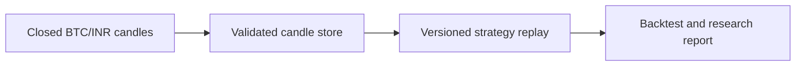
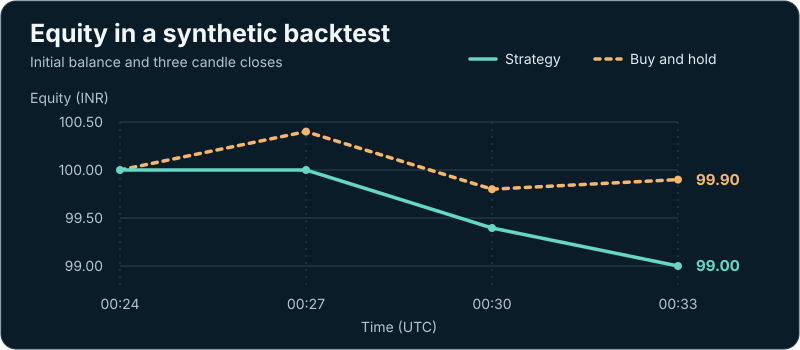

# TradeOS

**A personal quantitative research project for Bitcoin spot.**

TradeOS replays historical BTC/INR candles from Delta Exchange India to evaluate intraday strategies and simulate long-only spot trades in INR.

## Workflow

TradeOS preserves missing intervals as gaps and derives larger candles only from complete sets of smaller ones. Parquet holds the candle batches, and SQLite indexes them and stores backtest reports.

The Python strategy engine evaluates closed candles and records each BUY, SELL, or HOLD decision with its strategy version and reason codes. FastAPI exposes market data, signals, and saved reports.

## Strategies

| Strategy | Candle interval | What it evaluates |
| --- | --- | --- |
| VWAP / EMA9 crossover | 3 minutes | Looks for a lower-wick touch of session VWAP and a close that crosses above EMA9. Resets VWAP at midnight UTC. |
| EMA pullback | 15 minutes with 1-hour context | Looks for an EMA20 reclaim in an uptrend, with trend-strength and volatility filters. Uses ATR to set a stop and a target. |

## Backtest example

Orders from strategy signals can fill at the next scheduled candle open. The simulator accounts for fees, spread, slippage, liquidity limits, and partial fills. Each report includes orders and fills, closed trades, candle-close equity, drawdown, and a buy-and-hold comparison.

*This three-candle example comes from the synthetic test suite. The strategy buys 0.10 BTC in a partial fill, then closes the position. It starts with ₹100.00 and finishes at ₹99.00, including ₹0.20 in fees. The buy-and-hold benchmark finishes at ₹99.90.*

## Research and reproducibility

- **Chronological evaluation** runs training, validation, and holdout windows independently. When EMA pullback candidates are supplied, walk-forward evaluation selects settings using earlier data.
- **Cost sensitivity** compares the same strategy under zero, base, and higher trading costs.
- **Trade-block bootstrap** uses a fixed seed to estimate return and drawdown ranges when the sample has enough closed trades.
- **Run identity** ties saved reports to the input candle hash, code hash, and strategy settings fingerprint. Reports also record coverage gaps.
