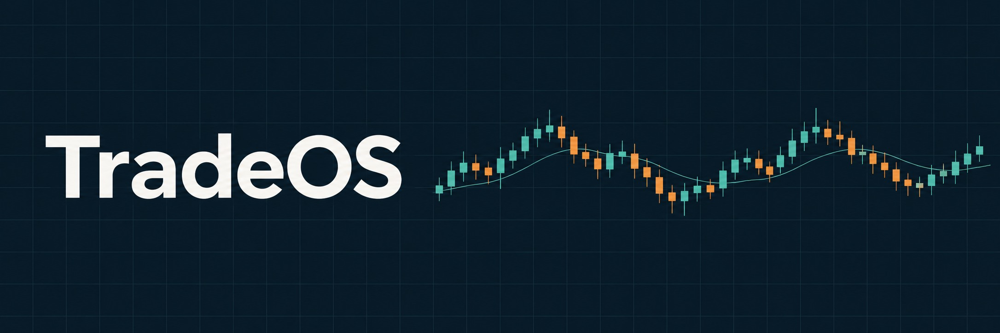

# TradeOS



TradeOS is a local research tool for **BTCUSD perpetual order-book imbalance on Delta Exchange India**. Record the public depth, trades, and mark-price feeds, then replay the recording to test an entry rule against executable prices and trading costs.

## Record and replay

```powershell
uv sync --locked
uv run python -m app.market.book_capture --output data/btcusd-session.jsonl --seconds 600
uv run python -m app.backtest --input data/btcusd-session.jsonl --output data/btcusd-research.json --ledger
```

Each recording retains messages in local receive order. The collector and replay verify the depth sequence and CRC32 checksum, and a new WebSocket connection starts a new book. The collector creates a fresh file for each session. [Delta public WebSocket documentation](https://docs.delta.exchange/#ob_updates)

## Strategy

- Add the contract sizes at the five best bids and asks. Divide the bid-minus-ask difference by the combined size.
- A long signal requires imbalance above **+0.30** for **two seconds** and a spread of at most **2 basis points**. The trade-confirmed rule also requires more taker-buy than taker-sell volume over those two seconds.
- The replay waits **250 ms** and buys available asks up to the margin cap. It starts with **₹100,000 equity** and uses up to **₹50,000 isolated margin at 25×**.
- The exit triggers at a **200-point stop**, at a target sized for **2:1 after modeled fees**, or after **five minutes**. The simulator applies the execution delay to exits and walks the visible bids. It checks liquidation against the sampled mark feed and leaves a position unresolved if a feed gap or the end of the file prevents an observed exit.

The simulation uses **5.9 bps in taker fees per side**, the exchange's fixed ₹85 settlement rate, and the recorded spread and depth. Entries near a funding boundary are skipped when their maximum holding period would cross it. [Fees](https://www.delta.exchange/fees) · [BTCUSD contract](https://api.india.delta.exchange/v2/products/BTCUSD) · [Settlement conversion](https://guides.delta.exchange/delta-exchange-india-user-guide/account-setup/usd-inr-rate)

## Read the research report

The report compares the book-only rule with the trade-confirmed rule. For each signal, it measures the mid-price move and the simulated net result from an executable exit after **10 seconds, 1 minute, and 5 minutes**. Markouts can overlap. The separate portfolio simulation holds one position at a time and reports closed P&L, drawdown, and unresolved positions.

The report pairs entries from the same imbalance episode to measure the effect of waiting for taker confirmation. It also compares chronological windows and checks **100 ms and 500 ms** execution delays. Forward observations that run past the file or cross a broken book sequence are counted separately. Use `--settings` with a JSON file to specify research assumptions. A profitability claim needs independent sessions across market conditions with rules fixed before evaluation.

The existing spot candle API and archived report lookup remain available for viewing historical data.
